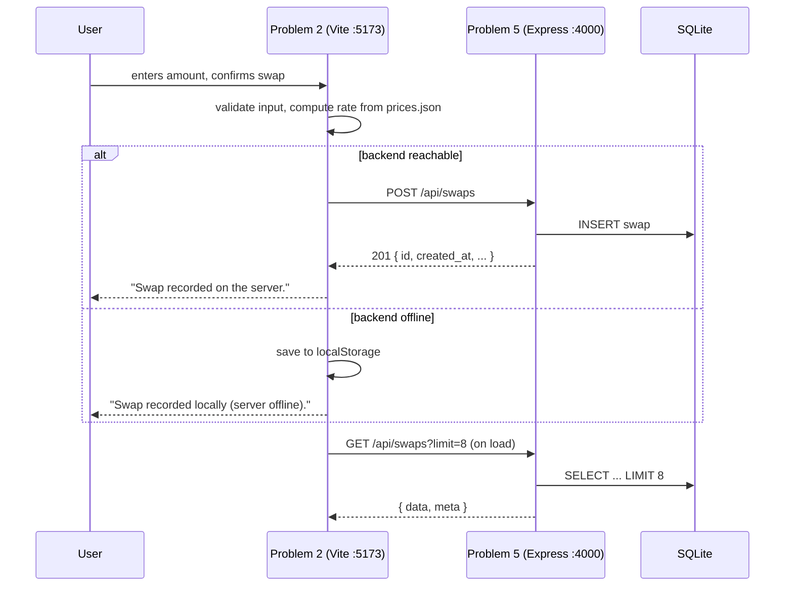
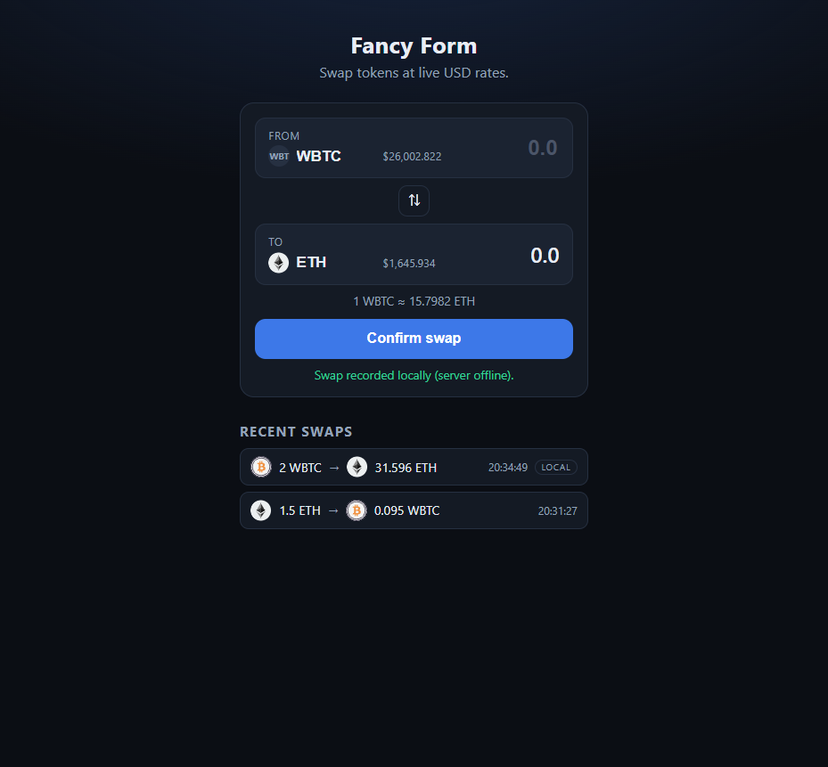
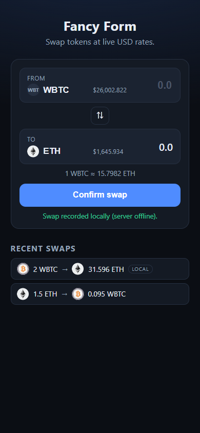

# 99Tech Code Challenge #1 — solutions (full submission)

Complete solutions for all six problems of the [99Tech / S5Tech code challenge](https://s5tech.notion.site/Code-Challenge-05cdb9e0d1ce432a843f763b5d5f7497), based on the official skeletal repo [`99techteam/code-challenge`](https://github.com/99techteam/code-challenge).

| # | Problem | Track | Solution | Stack |
| --- | --- | --- | --- | --- |
| 1 | Three ways to sum to n | Frontend | [`src/problem1`](src/problem1) | JavaScript + `node --test` |
| 2 | Fancy Form (currency swap) | Frontend / Fullstack | [`src/problem2`](src/problem2) | Vite + React 19 + TypeScript |
| 3 | Messy React (code review) | Frontend | [`src/problem3`](src/problem3) | review doc + refactored component |
| 4 | Three ways to sum to n | Backend / Fullstack | [`src/problem4`](src/problem4) | TypeScript + `node --test` |
| 5 | A Crude Server (CRUD) | Backend / Fullstack | [`src/problem5`](src/problem5) | Express 5 + TypeScript + SQLite |
| 6 | Architecture (live scoreboard spec) | Backend / Fullstack | [`src/problem6`](src/problem6) | README spec + Mermaid diagram |

Each folder is self-contained (own `package.json` where needed) — see its README for details.

## Quick start

Prerequisites: **Node.js >= 22.5**, npm.

```bash
# Problems 1 & 4 — no install needed
node --test "src/problem1/*.test.js"
node --test "src/problem4/*.test.ts"

# Problem 3 — typecheck the refactored component
cd src/problem3 && npm install && npm run typecheck

# Problem 2 — frontend
cd src/problem2 && npm install && npm run dev        # http://localhost:5173

# Problem 5 — backend (run in another shell)
cd src/problem5 && npm install && npm run dev        # http://localhost:4000

# Tests & production build
cd src/problem2 && npm test && npm run build
cd src/problem5 && npm test && npm run build
```

With the Problem 5 server running, the Problem 2 swap form persists every swap to the API (`POST /api/swaps`) and lists it under **Recent swaps**; with the server offline it falls back to `localStorage` and labels those entries `local`. See `src/problem2/vite.config.ts` for the dev proxy.

## Full-stack integration (Problems 2 + 5)






## Documentation

- [`docs/REQUIREMENTS.md`](docs/REQUIREMENTS.md) — repository discovery, requirement matrix, assumptions
- [`docs/FINAL_AUDIT.md`](docs/FINAL_AUDIT.md) — independent final audit: compliance matrix, E2E evidence, verdict
- [`src/problem3/REVIEW.md`](src/problem3/REVIEW.md) — Messy React findings (16 issues)
- [`src/problem5/README.md`](src/problem5/README.md) — full API contract
- [`src/problem6/README.md`](src/problem6/README.md) — live scoreboard module specification

## Verification performed

| Check | Command | Result |
| --- | --- | --- |
| Problem 1 tests | `node --test "src/problem1/*.test.js"` | 9/9 pass |
| Problem 4 tests | `node --test "src/problem4/*.test.ts"` | 11/11 pass |
| Problem 3 typecheck | `npm run typecheck` | pass |
| Problem 2 typecheck / tests / build | `npm run typecheck && npm test && npm run build` | pass (8/8 tests, production build OK) |
| Problem 5 typecheck / tests | `npm run typecheck && npm test` | pass (9/9 API tests) |
| Browser E2E | Vite dev + Express + SQLite | create → persist → list → filter → delete verified; offline fallback verified |

## Notes

- The brief leaves P5's resource model open; modelled as **swap records** so the backend is concrete and integrates with P2.
- P5 uses Node's built-in `node:sqlite` (experimental API, stable file format) to avoid native build steps; portable to `better-sqlite3`/Postgres.
- No authentication layer — none of the official problems require it.

---

*Note that if you fork this repository, your responses may be publicly linked to this repo.*

**Submission**: this repository is the submission — each problem lives under `src/problemN/`.
